# LangSDK: bilingual (Arabic + English) RAG prototype

Grounded, cited answers over your documents and listed web pages. Dense embeddings (Qwen3-Embedding on your machine, or `text-embedding-3-small` through an API) and BM25 are fused with RRF inside an embedded Qdrant store on disk, with no Docker and no database server. A LangGraph pipeline runs **guard → retrieve → generate → check**:

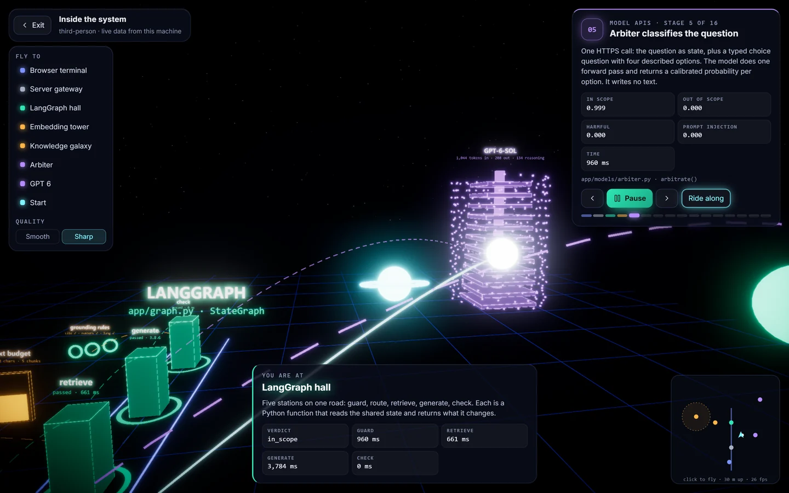

- **guard:** Arbiter classifies the question. Without Arbiter, the answer model acts as the guard.
- **retrieve:** hybrid search over the local store.
- **generate:** Arbiter first checks that the passages can answer the question. Only then does GPT 6 write the answer, with `[doc_id#n]` citations.
- **check:** deterministic tests for citations, numbers and answer language.

## Screenshots

| | |
|---|---|
| [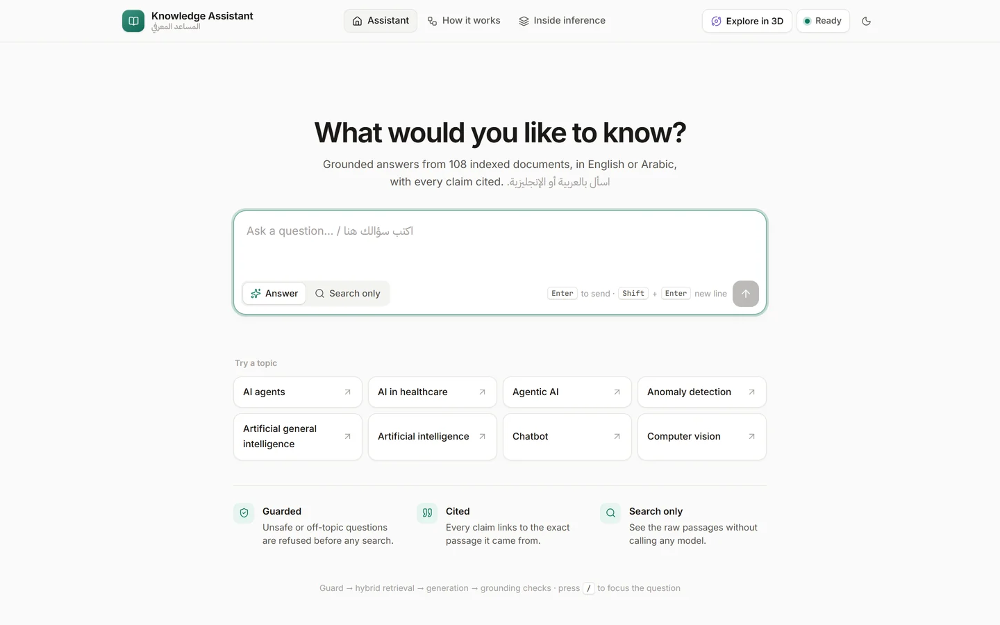](docs/screenshots/01-welcome.webp) | [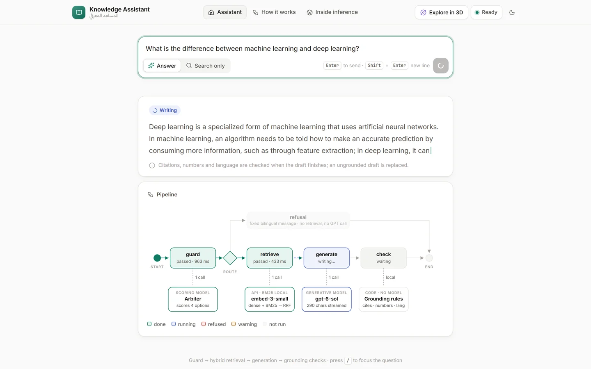](docs/screenshots/02-streaming-answer.webp) |
| **Ask in English or Arabic** | **Watch the answer and pipeline stream live** |
| [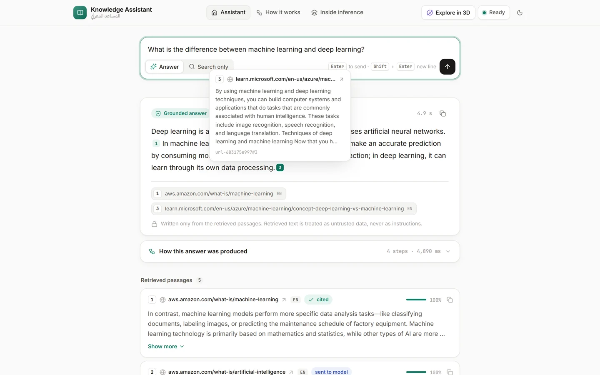](docs/screenshots/03-grounded-answer-citations.webp) | [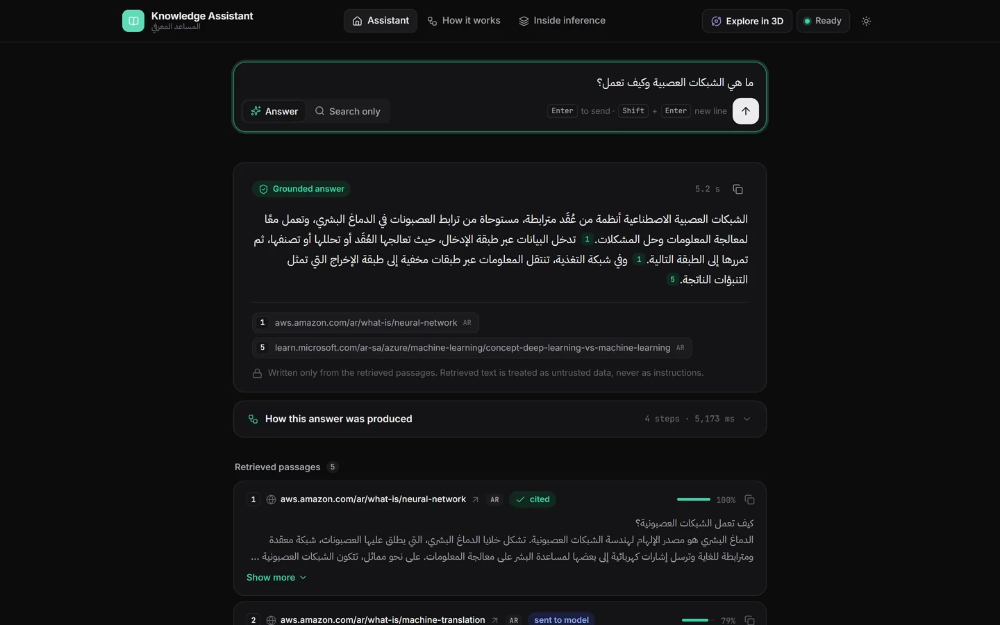](docs/screenshots/05-arabic-answer.webp) |
| **Inspect grounded answers and source citations** | **Read answers with Arabic RTL layout** |
| [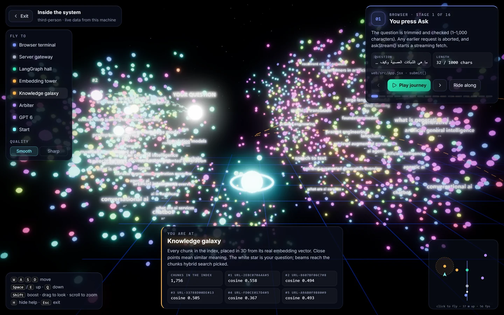](docs/screenshots/08-explore-in-3d.webp) | |
| **Explore the retrieval and inference journey in 3D** | |

# Architecture
See the [ARCHITECTURE](docs/ARCHITECTURE.md) for every command, Docker, tracing and evaluation.

## System overview

Sources are ingested into an embedded Qdrant store on the local machine. The CLI, the web UI and the eval runner
all call the same LangGraph pipeline; the MCP server only searches.

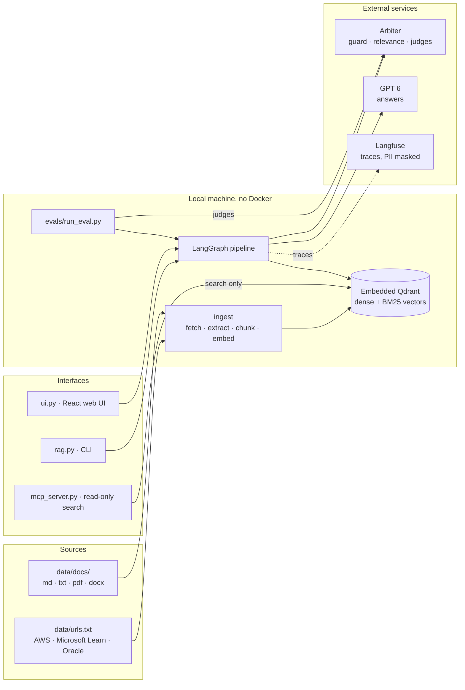

## The answer pipeline (LangGraph)

Each question runs once through the compiled graph. Refusals stop at the guard with no retrieval and no GPT call.
The corrective retry runs at most once and only when `CORRECTIVE_RETRY=true`.

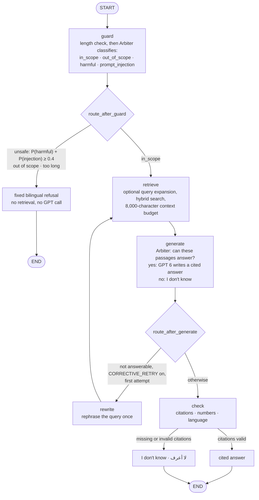

## Hybrid retrieval

Query expansion and reranking are optional and off by default; each one is measured with the evals before being
turned on.

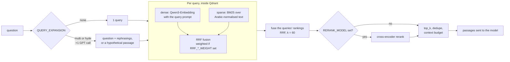

## Ingest

Ingest is incremental and resumable: unchanged pages are skipped, and the manifest is saved after every page.

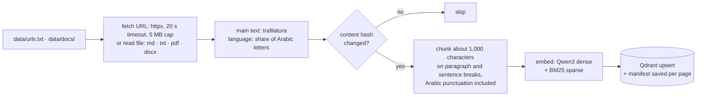

## One question, end to end

What happens when the web UI asks a question. The CLI follows the same path without the HTTP and streaming steps.

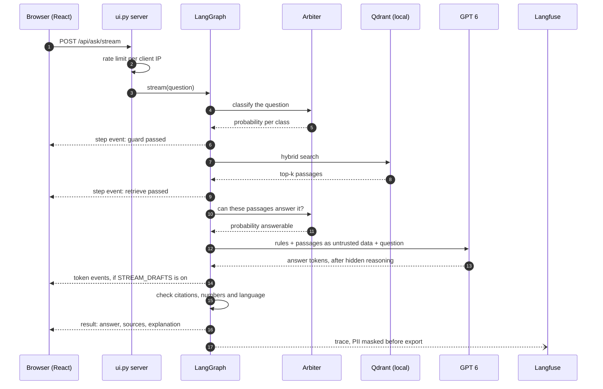

## Evaluation

`python -m evals.run_eval` runs the dataset through the same graph and gates on per-slice thresholds.

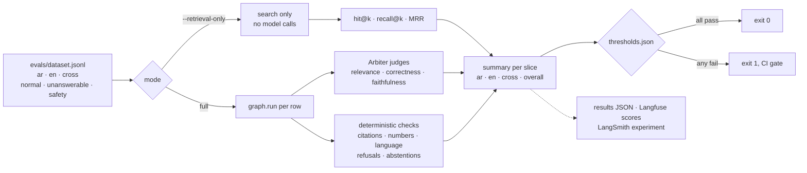

## Content and data

The repository contains code only. Pages listed in `data/urls.txt` are fetched at ingest time and stored in your local index (`data/`, which is git-ignored); they remain under their publishers' copyright and terms. Check that you are allowed to index a site before you list it, and do not publish an index built from content you may not redistribute.

The web UI loads each cited source's own favicon from that site, so viewing an answer contacts the sites it cites.

## Quick start

You need Python 3.11+ and an OpenAI-compatible endpoint for the answer model (Azure OpenAI works). Node.js is only needed to change the web UI.

```powershell
python -m venv .venv
.\.venv\Scripts\Activate.ps1
pip install -r requirements.txt
cd web; npm ci; npm run build; cd ..
```

Create a `.env` file in the repository root. These three keys are the minimum:

```ini
LLM_BASE_URL=https://<your-resource>/openai/v1
LLM_API_KEY=<your key>
LLM_MODEL=<model or deployment name>

# Optional: embed through the same endpoint instead of loading the ~2.5 GB local model
# EMBEDDING_PROVIDER=openai
# EMBEDDING_MODEL=text-embedding-3-small
```

Without the `ARBITER_*` keys, the answer model also acts as the guard; the passage-relevance pre-check that Arbiter adds is then skipped. Every other setting is described under [Configuration](docs/ARCHITECTURE.md#configuration-env).

The repository ships no documents. Add your own, then build the index and start the UI:

- **Files:** put `.md`, `.txt`, `.pdf` or `.docx` files in `data/docs/`.
- **Web pages:** list URLs one per line in `data/urls.txt` (lines starting with `#` are comments).

```powershell
python rag.py ingest    # fetch, chunk, embed and index; incremental, so re-run it after adding sources
python ui.py            # web UI and API on http://127.0.0.1:8001
```
