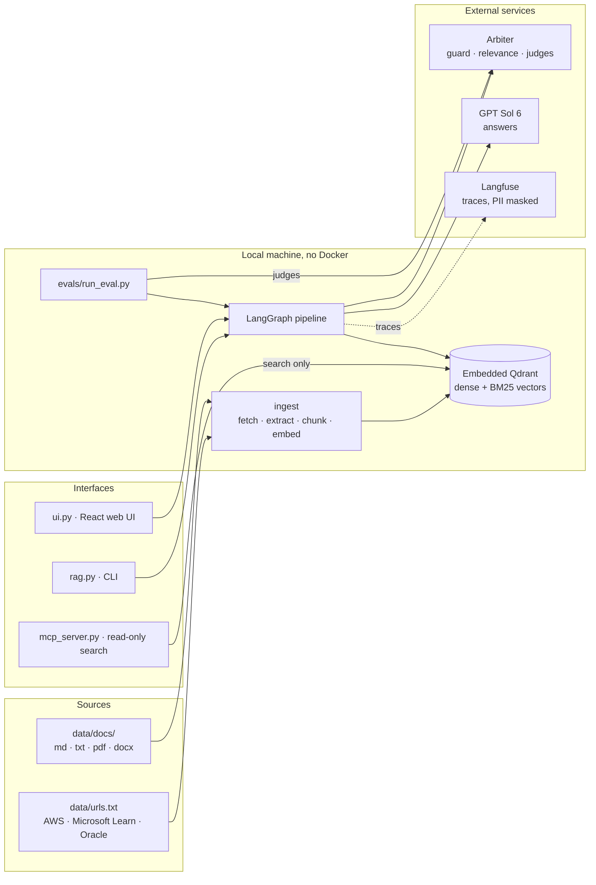
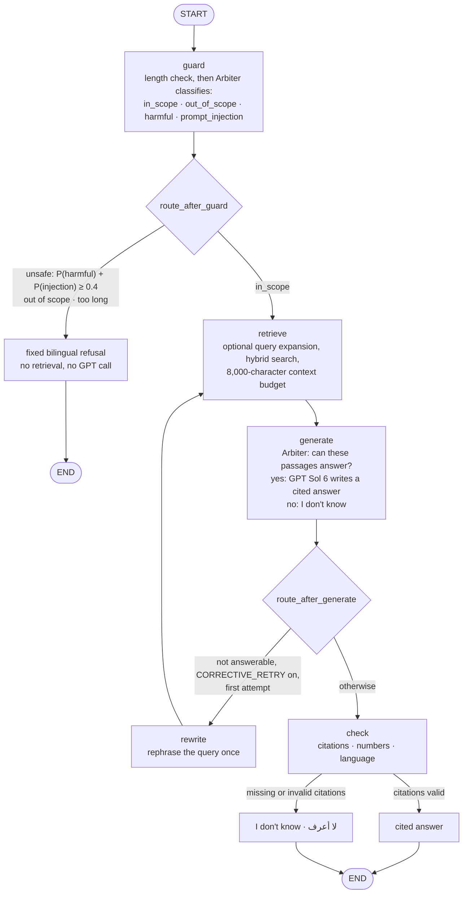
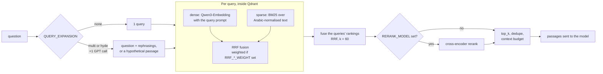
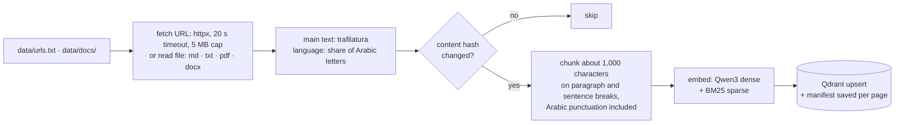
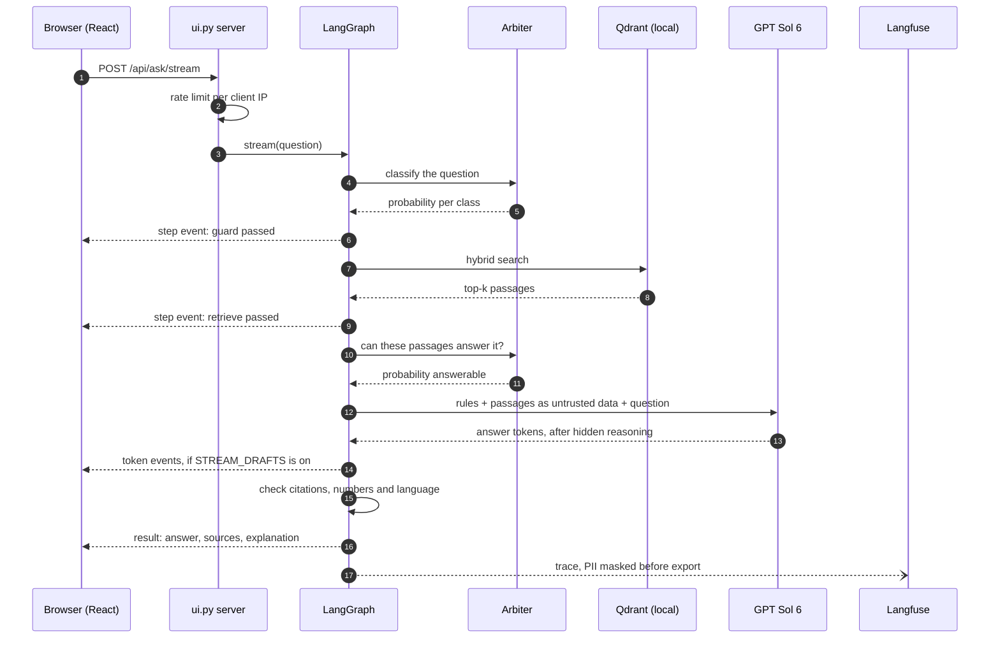
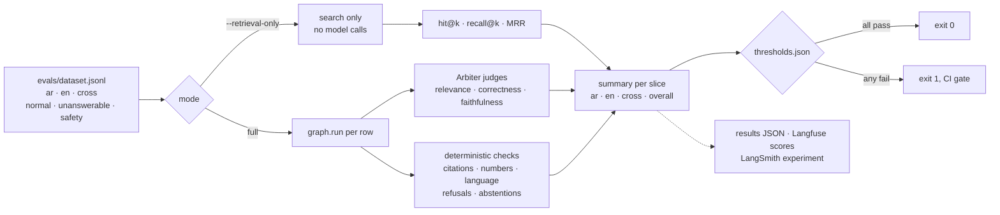

# Architecture

Diagrams of how the system fits together. They are written in Mermaid, which GitHub and VS Code render directly.
See the [README](../README.md) for setup and commands.

## System overview

Sources are ingested into an embedded Qdrant store on the local machine. The CLI, the web UI and the eval runner
all call the same LangGraph pipeline; the MCP server only searches.

## The answer pipeline (LangGraph)

Each question runs once through the compiled graph. Refusals stop at the guard with no retrieval and no GPT call.
The corrective retry runs at most once and only when `CORRECTIVE_RETRY=true`.

## Hybrid retrieval

Query expansion and reranking are optional and off by default; each one is measured with the evals before being
turned on.

## Ingest

Ingest is incremental and resumable: unchanged pages are skipped, and the manifest is saved after every page.

## One question, end to end

What happens when the web UI asks a question. The CLI follows the same path without the HTTP and streaming steps.

## Evaluation

`python -m evals.run_eval` runs the dataset through the same graph and gates on per-slice thresholds.

